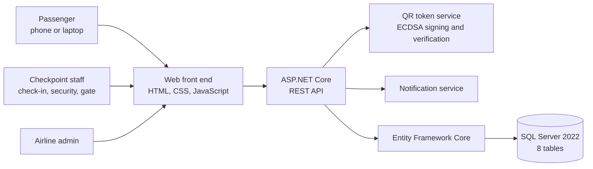
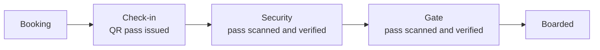

# OneBoard

**One signed QR pass for the entire airport journey.**

OneBoard is a full-stack web application that replaces repeated document checks at the airport with a single digital boarding pass. One QR code takes the passenger through check-in, security and boarding, while live flight updates keep them informed along the way.

I lead a team of four on this project as part of my final year at CTU Training Solutions.

> **Note:** This is a showcase repository. The source code is kept private, and this page covers the design, features and architecture.

## Screenshots

| | |
|---|---|
|  |  |
| Login and registration | Digital QR boarding pass |
|  |  |
| Live journey tracker | Checkpoint verification |
|  |  |
| Admin console | Live flight notifications |

 Mobile view

## The problem

A passenger shows their ID and booking several times before reaching the gate: at check-in, at security and again at boarding. Every check is manual, slow and repeats the one before it.

## The solution

OneBoard issues one digitally signed QR pass after check-in. Each checkpoint scans the same pass, verifies its signature and records the passenger's progress. The airline can push delays, gate changes and boarding calls straight to the passenger.

## Features

- **Single QR pass** that is valid across check-in, security and boarding
- **Live journey tracker** showing the passenger which stages are done and which are next
- **Real-time notifications** for delays, gate changes and boarding calls
- **Admin console** that lets airport staff manage flights and trigger updates
- **South African ID validation** using the Luhn checksum, the citizenship digit and an age rule
- **Works on laptops and phones**

## Security by design

- QR passes are signed with **ECDSA (P-256)** and **expire**, so they can't be forged or reused
- The QR code holds **no personal information**. It only carries a signed token that the server verifies
- Passwords are **hashed**, and sessions use **secure cookies**

## Architecture

### Passenger journey

## Built with

| Layer | Technology |
|---|---|
| Front end | HTML, CSS, JavaScript |
| Back end | C#, ASP.NET Core (.NET 10), REST APIs |
| Data | SQL Server 2022, Entity Framework Core (database-first) |
| Security | ECDSA P-256 signed tokens, password hashing, secure cookies |
| Collaboration | Git, GitHub organisation, code reviews |

## My role

As team lead, I:

- defined the requirements and the system architecture
- set up and managed the team's GitHub organisation and access
- led code reviews and kept the team on track
- wrote the technical documentation and setup guide
- used AI-assisted development (Claude Code), compiling, running and testing every change myself

## Status

In active development (2026).

## Contact

Zafar Seepye · [LinkedIn](https://www.linkedin.com/in/zafarseepye) · [GitHub](https://github.com/ZafarSeepye)
